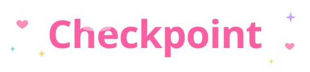

  

  

  

  
  
  

  
  
  
  

  

## About (｡•ᴗ•｡)

Checkpoint is a cute little game tracker for everything you play: your backlog, the games you want to 100%, and the competitive games that never really end.

Most trackers expect every game to have an ending. Checkpoint gives PvP games their own space with ranks, mains and clips instead ♡

## Features ✧(◕‿◕)✧

<table>
<tr>
<th width="50%">♡ tracking</th>
<th width="50%">✧ your profile</th>
</tr>
<tr>
<td valign="top">

˚₊ Search any game, its picture and info fill in by themselves 
˚₊ Completion checklists for bosses, collectibles and achievements 
˚₊ A PvP section with current rank, peak rank and your main 
˚₊ Clips from YouTube, Twitch or Streamable 
˚₊ A physical collection tab for discs, cartridges and collector's editions 
˚₊ Themes, colors and fonts you can change

</td>
<td valign="top">

˚₊ Your own username and profile link 
˚₊ A profile theme everyone sees, or match it to your picture 
˚₊ Badges you earn as you play 
˚₊ Gamer tags that open your U.GG, Tracklock and Steam pages 
˚₊ Connect Steam for verified hours that can't be faked 
˚₊ Steam achievements tracked for every game 🏆 
˚₊ Live "now playing" from Steam and Discord 
˚₊ Alt accounts, and a library anyone can browse from your profile 
˚₊ Friends and followers, you choose what's shown

</td>
</tr>
</table>

## Two ways to use it (˶ᵔ ᵕ ᵔ˶)

<table>
<tr>
<th width="50%">🌸 just your browser</th>
<th width="50%">☁️ with an account</th>
</tr>
<tr>
<td valign="top">

˚₊ No sign-up, just open and start 
˚₊ Saved on this device only 
˚₊ Use **Customize → Export backup** to keep a copy

</td>
<td valign="top">

˚₊ Click **Sign in → Create account** 
˚₊ Saves by itself every time you change something 
˚₊ Sign in on your phone to see the same games

</td>
</tr>
</table>

> [!NOTE]
> Already have games in your browser? Signing in keeps them. If your account has games too, Checkpoint asks which ones to keep.

## How to use (っ◔◡◔)っ

✧ Open the [live site](https://aegyoer.github.io/checkpoint/) 
✧ Click **+ Add game** and type a title 
✧ Click a game to add checklist items, ranks, clips and notes 
✧ Make it yours in **Customize** and **Profile**

## Library vs PvP (•̀ᴗ•́)و

| | 📚 Library | ⚔️ PvP |
|---|---|---|
| **For** | games you can finish | competitive & live-service games |
| **Statuses** | backlog · playing · completed · dropped · wishlist | main game · casual · on a break · retired |
| **Track** | checklists and % complete | current rank, peak rank and main |

## Roadmap (๑˃ᴗ˂)ﻭ

- [x] Backlog tracker with checklists
- [x] PvP section with ranks and mains
- [x] Clips
- [x] Themes and profile
- [x] Game search with pictures
- [x] Accounts that save everywhere
- [x] Public profiles, usernames and friends
- [x] Live Steam and Discord status
- [x] Steam sign-in with verified hours + library import
- [x] Steam achievements
- [ ] League and Valorant ranks (waiting on Riot)
- [ ] Community checklists

## Found a bug or have an idea? ( ˘▽˘)っ♡

Both buttons open a short form. Screenshots are welcome!

  
  

  

  Game info from <a href="https://www.wikipedia.org">Wikipedia</a> · Accounts by <a href="https://supabase.com">Supabase</a> · Logos by <a href="https://simpleicons.org">Simple Icons</a> · GIFs belong to their original artists · <a href="LICENSE">MIT License</a>

  <b>made with ♡ by <a href="https://github.com/aegyoer">aegyoer</a></b>

