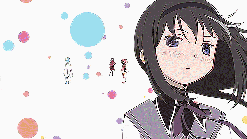
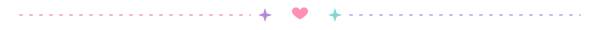
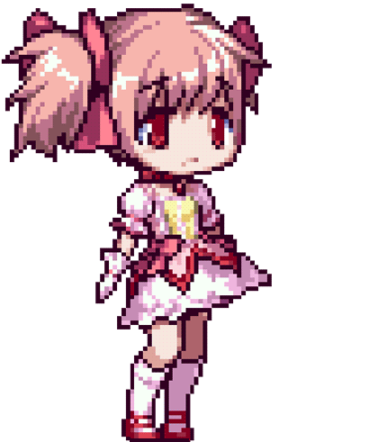
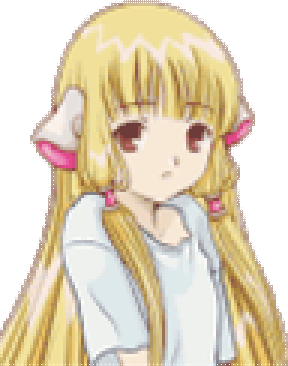

<h1>Checkpoint (˶ᵔ ᵕ ᵔ˶)</h1>

Track your backlog, 100% your games and log your PvP ranks.

## About (｡•ᴗ•｡)

Checkpoint is a game tracker for everything you play: your backlog, the games you want to fully complete, and the competitive games that never really end.

Most trackers expect every game to have an ending. Checkpoint gives PvP games their own section with ranks, mains and clips instead.

No account needed. Your data is saved in your browser.

 

## Features ✧(◕‿◕)✧

♡ Game search that fills in banners and info 
♡ Completion checklists for bosses, collectibles and achievements 
♡ PvP section with current rank, peak rank and your main 
♡ Clips from YouTube, Twitch or Streamable 
♡ Custom profile with banner, picture, bio and gamer tags 
♡ Themes, colors and fonts you can change 
♡ Export and import backups 
♡ Works on phones

 

## Library vs PvP (•̀ᴗ•́)و

| | Library | PvP |
|---|---|---|
| **For** | games you can finish | competitive & live-service games |
| **Statuses** | backlog · playing · completed · dropped · wishlist | main game · casual · on a break · retired |
| **Track** | checklists and % complete | current rank, peak rank and main |

## How to use (っ◔◡◔)っ

✧ Open the [live site](https://YOURNAME.github.io/checkpoint/) 
✧ Click **+ Add game** and type a title 
✧ Click a game to add checklist items, ranks, clips and notes 
✧ Change the look in **Customize** and **Profile**

> [!TIP]
> Your data is stored in your browser. Use **Customize → Export backup** now and then so you don't lose it.

## Roadmap (๑˃ᴗ˂)ﻭ

- [x] Backlog tracker with checklists
- [x] PvP section with ranks and mains
- [x] Clips
- [x] Themes and profile
- [x] Game search with banners
- [ ] Accounts and shareable profiles
- [ ] Steam library import
- [ ] Riot and Battle.net stats
- [ ] Community checklists

## Run it yourself ( ˘▽˘)っ

⋆ Download `index.html` and open it in your browser 
⋆ *(Optional)* For game search, get a free key at [rawg.io/apidocs](https://rawg.io/apidocs) and paste it into `RAWG_KEY` near the top of the file

Game info from <a href="https://rawg.io">RAWG</a> · GIFs belong to their original artists · <a href="LICENSE">MIT License</a>

